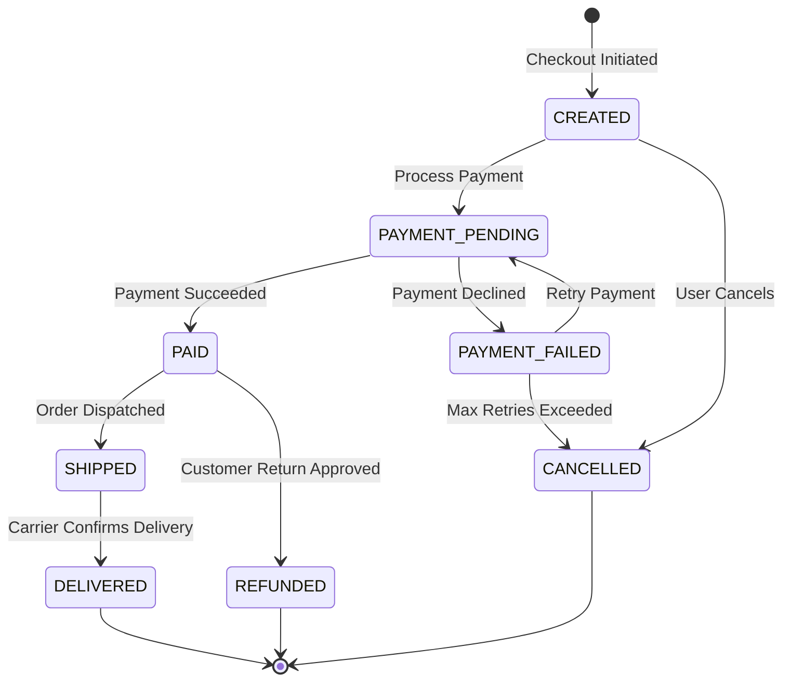

# Foundations of System Design & Backend Architecture

---

## 1. Architecture vs. Software Design

A common source of confusion for engineers is the distinction between **Architecture** and **Design**:

| Dimension | System Architecture | Software Design |
| :--- | :--- | :--- |
| **Scope** | **Macro-level**: The big building blocks, how they communicate over networks, and where they run. | **Micro-level**: How each individual service/block is constructed internally. |
| **Focus** | Services, Message Queues, Databases, Caches, Load Balancers, LLM APIs. | Modules, classes, interfaces, Finite State Machines, design patterns. |
| **Cost of Change** | **Extremely expensive** to change later (e.g. migrating from Postgres to Cassandra or REST to Kafka). | **Locally manageable** to refactor without breaking other services. |
| **Analogy** | The architectural floor plan, foundation, and municipal plumbing of a house. | The interior design, electrical wiring inside a single room, and furniture placement. |

---

## 2. The Blueprint: How Modern Backend Systems Are Structured

Every scalable, distributed backend follows a standardized end-to-end pipeline that ties together all the topics in these notes:

```mermaid
flowchart TD
    subgraph External["1. External World"]
        Meta[Meta / Stripe / Client]
    end

    subgraph Ingestion["2. Ingestion Tier (Stateless)"]
        LB[Load Balancer]
        API["Webhook / API Service<br/>• Verify HMAC Signature<br/>• Check Timestamp / Replay<br/>• Fast ACK (200 OK in <500ms)"]
    end

    subgraph Buffering["3. Asynchronous Buffer"]
        MQ["Message Queue / Stream<br/>(SQS / RabbitMQ / Kafka)<br/>• Visibility Timeout<br/>• Retries & DLQ"]
    end

    subgraph Processing["4. Worker Tier (Stateless)"]
        Worker["Background Consumer Workers<br/>• Idempotent Processing<br/>• FSM State Transitions<br/>• LLM / 3rd Party Integrations"]
    end

    subgraph Storage["5. Persistence Tier (Stateful)"]
        DB[("PostgreSQL Database<br/>• Multi-Tenancy (tenant_id)<br/>• Row Level Security (RLS)<br/>• Optimistic Locking (version)")]
        Redis[("Redis Cache<br/>• Distributed Sessions<br/>• Rate Limiting")]
    end

    Meta -->|HTTPS POST| LB
    LB --> API
    API -->|1. Enqueue Event| MQ
    API -->>|2. Immediate 200 OK| Meta
    MQ -->|Poll / Stream| Worker
    Worker -->|State Machine Transitions| DB
    Worker -->|Session / Cache / Lock| Redis
```

---

## 3. Synchronous vs. Asynchronous Processing: The Fast ACK Rule

When receiving external requests or webhooks, services must make a fundamental choice:

```
Synchronous (Anti-Pattern for Heavy Tasks):
Client ──[ POST /webhook ]──> Server ──[ Heavy Work (10s) ]──> Client ──[ 200 OK ]
*(Client connection blocks, risk of timeouts, network retries, and server thread exhaustion)*

Asynchronous Pattern (The Gold Standard):
Client ──[ POST /webhook ]──> Server ──[ Push to Queue ]──> Client ──[ 200 OK (< 200ms) ]
                                             │
                                             ▼
                                     Worker ──[ Background Processing ]
```

### Why We Acknowledge Fast and Process Later:
1. **Prevent Timeout Retry Storms:** Webhook providers (Meta, Stripe, GitHub) enforce strict HTTP timeouts (typically 3–5 seconds). If your server takes 6 seconds to generate a PDF or call an LLM, the provider marks the attempt as failed and retries, triggering duplicate jobs.
2. **Protect Web Server Threads:** Web servers (Gunicorn, Node.js, Uvicorn) have finite thread/connection pools. Freeing HTTP connections immediately prevents thread starvation during traffic spikes.
3. **Fault-Isolated Execution:** If background processing crashes, the message remains safely stored in the queue for retries without impacting the user-facing HTTP endpoint.

---

## 4. Stateless Services: Why State Lives in the Database, Not in Memory

Following the **12-Factor App methodology (Factor VI: Stateless Processes)**, backend application servers must be completely **stateless and share-nothing**.

```
❌ BAD: Stateful Server (In-Memory State)
[ User Request ] ──> [ Server A (Stores session in RAM: user_id=42) ]
[ Next Request ] ──> [ Server B (Error! Who is user 42? Session lost!) ]

✅ GOOD: Stateless Servers (Externalized State)
[ User Request ] ──> [ Server A ] ──┐
                                     ├──> [ Shared Redis / PostgreSQL ]
[ Next Request ] ──> [ Server B ] ──┘     (Source of Truth)
```

### Why Storing State in Server Memory Breaks at Scale:
1. **Horizontal Auto-Scaling:** When traffic surges, cloud auto-scalers spin up 20 new instances and tear down idle ones. Any state stored in a dying server's RAM vanishes permanently.
2. **Load Balancing Complexity:** If servers are stateful, load balancers must use *Sticky Sessions* (pinning a user to a specific server IP). If that server crashes or restarts during deployment, the user is forcefully logged out.
3. **Zero-Downtime Rolling Deployments:** When deploying new code versions, old servers are killed sequentially. In a stateless architecture, requests seamlessly route to new servers without interrupting active user workflows.

### Where Does State Actually Live?
* **Ephemeral / Session State:** Distributed In-Memory Cache (**Redis / Memcached**) for JWT blacklists, active user sessions, and rate-limiting counters.
* **Persistent Business State:** Relational / NoSQL Databases (**PostgreSQL, MySQL, DynamoDB**) for user profiles, financial balances, and transactional records.
* **Blob / File State:** Object Storage (**AWS S3, Google Cloud Storage**) for uploaded images, videos, and generated PDFs.

---

## 5. Finite State Machines (FSM) in System Design

A **Finite State Machine (FSM)** is an architectural pattern that models an entity's lifecycle through a finite number of **States**, triggered by **Events**, executed via **Transitions**, and protected by **Guards**.

### Why FSMs Are Crucial for Backend Systems
Without an FSM, systems rely on ad-hoc `if/else` checks scattered across code, leading to invalid states (e.g. refunding an order before payment, or delivering an order that was cancelled).

### E-Commerce Order Lifecycle Example:



### The 4 Core Building Blocks of an FSM:
1. **States:** Discrete conditions an entity can exist in (`CREATED`, `PAID`, `SHIPPED`, `CANCELLED`).
2. **Events:** Triggers from the outside world (`payment_success_webhook`, `cancel_button_clicked`).
3. **Transitions:** Valid pathways from one state to another (e.g., `CREATED` $\rightarrow$ `PAID` is valid; `CANCELLED` $\rightarrow$ `SHIPPED` is **strictly forbidden**).
4. **Guards / Invariants:** Business rules that must be true before a transition executes (e.g., `inventory_count > 0`).

---

### Concurrency & Safe State Transitions in Distributed Systems

In distributed architectures with multiple workers, two workers might receive events for the same order simultaneously (e.g. `PAYMENT_SUCCESS` webhook and `USER_CANCELLED` button).

#### 1. Atomic Compare-And-Swap (CAS) in SQL
Never read an entity, modify it in Python memory, and save it blindly. Perform the state validation and update in a single atomic SQL statement:

```sql
-- Atomic Transition: Only mark as PAID if currently PAYMENT_PENDING
UPDATE orders 
SET status = 'PAID', updated_at = NOW() 
WHERE id = 'ord_123' AND status = 'PAYMENT_PENDING';
```
* If `rows_affected == 1`: The transition succeeded.
* If `rows_affected == 0`: Another process already modified the state or the state was invalid. Safely abort and roll back.

#### 2. Optimistic Locking with Versioning
Add a `version` column to guard against lost updates:

```sql
UPDATE orders 
SET status = 'SHIPPED', version = version + 1 
WHERE id = 'ord_123' AND version = 3;
```

---

## 6. System Design Notes Directory Map

Explore the dedicated deep-dive guides for each component of the architecture:

| Topic & Guide | Core Concepts Covered |
| :--- | :--- |
| **[webhook.md](../webhook.md)** | • How Webhooks Work (Producer vs Consumer)<br/>• **HMAC-SHA256 Signature Verification** (Verifying Meta/Stripe requests)<br/>• Replay Attack Prevention (Timestamps + Tolerance Windows)<br/>• Zero-Downtime Secret Rotation (Dual-Secret Rolling Window)<br/>• Python FastAPI implementation |
| **[message_queues.md](../message_queues.md)** | • **At-Least-Once Delivery** guarantees<br/>• **Visibility Timeouts** & Acknowledgements (ACK/NACK)<br/>• Consumer Lag & Horizontal Worker Scaling<br/>• **Dead Letter Queues (DLQ)** & Poison Pills<br/>• Building **Idempotent Consumers**<br/>• AWS SQS vs. RabbitMQ vs. Kafka vs. Redis |
| **[multi_tenant.md](../multi_tenant.md)** | • Single-Tenant vs. Multi-Tenant trade-offs<br/>• 3 Isolation Models: Database-per-tenant, Schema-per-tenant, Shared-Table<br/>• **PostgreSQL Row Level Security (RLS)** & Session Variables<br/>• Noisy Neighbor mitigation (Rate Limiting & Tiered Hybrid Models) |
