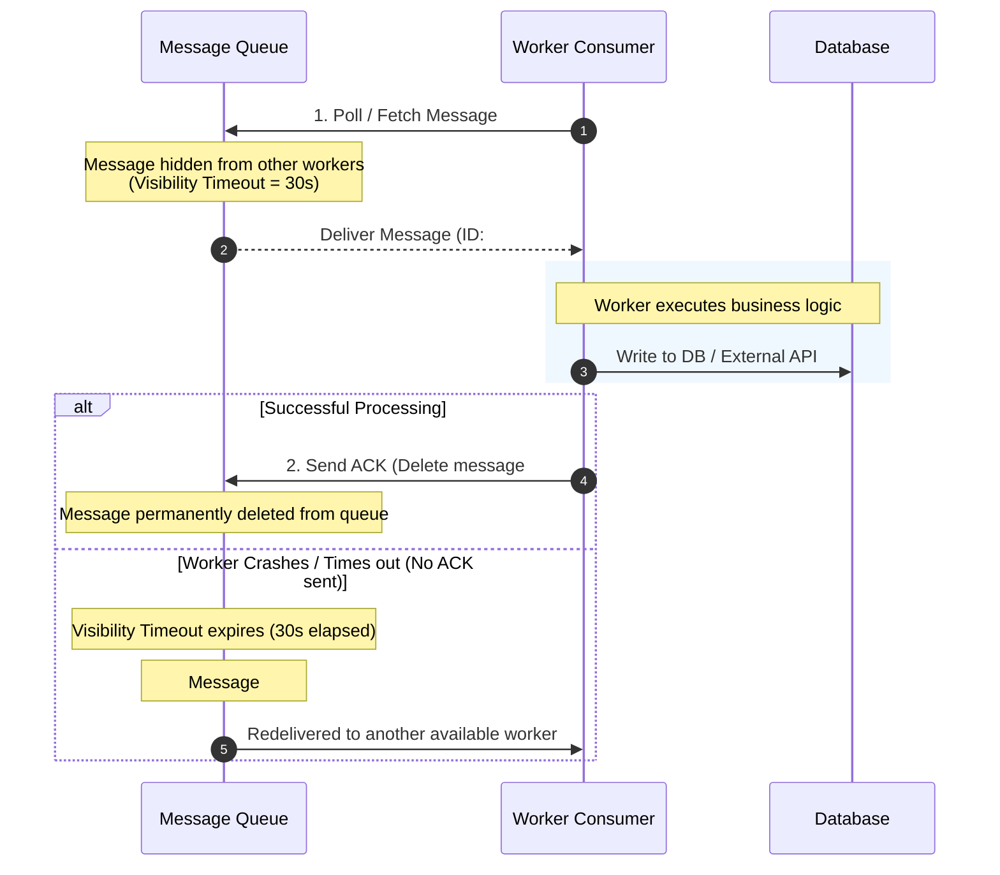

# Comprehensive Guide to Message Queues: System Design & Architecture

> **Reference Video:** [Message Queues in System Design Interviews w/ Meta Staff Engineer (Hello Interview)](https://www.youtube.com/watch?v=1ISRd0bS714)

---

## 1. What is a Message Queue?

A **Message Queue (MQ)** is an asynchronous communication middleware component that enables software services to communicate by sending messages to one another without requiring direct, synchronous connections.

### The Real-World Analogy
* **Synchronous Communication (Direct HTTP / RPC):** Like a direct phone call. Both caller (Producer) and receiver (Consumer) must be online, attentive, and available at the exact same moment. If the receiver is busy or crashes, the call drops and fails.
* **Asynchronous Communication (Message Queue):** Like an inbox or physical post office. The sender drops a letter into the mailbox and immediately moves on with their day. The post office holds the letter safely until the recipient picks it up, even if the recipient was sleeping when the letter was dropped off.

```
+---------------+     1. Publish Message      +--------------------+     2. Consume Message     +----------------+
|   Producer    | --------------------------> |   Message Queue    | -------------------------> |    Consumer    |
| (Web Service) |                             | (Buffer / Storage) |                            | (Async Worker) |
+---------------+                             +--------------------+                            +----------------+
                                                                                                        │
                                                               3. Acknowledge (ACK)                     │
                                              <─────────────────────────────────────────────────────────┘
```

---

## 2. Why Do We Need Message Queues? (Core Benefits)

In modern distributed systems and system design interviews, message queues solve five fundamental problems:

```
                      ┌────────────────────────────────────────┐
                      │    Core Benefits of Message Queues     │
                      └───────────────────┬────────────────────┘
          ┌─────────────────┬─────────────┼─────────────┬─────────────────┐
          ▼                 ▼             ▼             ▼                 ▼
   ┌─────────────┐   ┌─────────────┐┌───────────┐┌─────────────┐   ┌─────────────┐
   │ Decoupling  │   │ Asynchronous││  Traffic  ││    Fault    │   │ Independent │
   │ of Services │   │ Processing  ││ Smoothing ││  Tolerance  │   │ Scalability │
   └─────────────┘   └─────────────┘└───────────┘└─────────────┘   └─────────────┘
```

### 1. Decoupling (Separation of Concerns)
* The **Producer** doesn't need to know who the **Consumer** is, what language it is written in, what its IP address is, or how many consumer instances exist.
* Services can evolve, deploy, and upgrade independently.

### 2. Asynchronous Processing & Fast User Responses
* Defer time-consuming operations (e.g., generating PDFs, sending confirmation emails, video encoding, updating search indexes, executing fraud checks).
* Return a fast `200 OK` or `202 Accepted` to the client in milliseconds while offloading heavy tasks to background workers.

### 3. Traffic Smoothing & Load Leveling (Buffering)
* **Problem:** During a Flash Sale or Black Friday, traffic spikes from 1,000 req/sec to 50,000 req/sec. If every request synchronously hit the payment gateway or relational database, the database would crash.
* **Solution:** The queue acts as a shock absorber / buffer. Producers can push messages at peak rates, while consumers pull and process messages at a steady, sustainable rate without overloading downstream systems.

### 4. Fault Tolerance & Resilience
* If consumer instances crash or undergo maintenance, messages remain persisted in the queue.
* Once the consumer restarts, it resumes reading from the queue where it left off—**zero data loss**.

### 5. Independent Horizontal Scalability
* If the queue begins building up a backlog (known as *consumer lag*), you simply spin up more consumer worker instances to drain the queue faster, without touching the producer service.

---

## 3. Communication Patterns: Work Queues vs. Pub/Sub vs. Event Streams

Different queue technologies support different architectural paradigms:

```
Pattern 1: Point-to-Point (Work Queue)
[ Producer ] ───> [ Queue ] ───┬───> [ Worker A ] (Message 1)
                               └───> [ Worker B ] (Message 2)
*(Each message is processed by EXACTLY ONE worker)*

Pattern 2: Publish-Subscribe (Pub/Sub)
                               ┌───> [ Email Service Queue ] ───> [ Email Worker ]
[ Producer ] ───> [ Topic ] ───┤
                               └───> [ Analytics Queue ]     ───> [ Analytics Worker ]
*(Each subscriber gets a copy of EVERY message)*
```

### A. Point-to-Point (Work Queues)
* **Behavior:** Multiple workers compete for messages from a single queue. Each individual message is consumed and processed by **only one** worker.
* **Examples:** AWS SQS Standard, Celery with RabbitMQ, BullMQ with Redis.
* **Best For:** Task distribution (e.g., image resizing jobs, sending transactional SMS).

### B. Publish-Subscribe (Pub/Sub)
* **Behavior:** A producer publishes a message to a **Topic**. Multiple independent consumer systems subscribe to the topic. Every subscriber receives a complete copy of the message.
* **Examples:** AWS SNS, Google Cloud Pub/Sub, RabbitMQ Fanout Exchange.
* **Best For:** Broadcasting domain events (e.g., `OrderPlaced` event received by Inventory, Billing, and Shipping services).

### C. Log-Based Distributed Streaming (Kafka / Kinesis)
* **Behavior:** Messages are stored in an immutable, partitioned, append-only log on disk. Messages are **retained** for a configured duration (e.g., 7 days), not deleted upon consumption.
* **Offset Mechanism:** Each consumer group tracks its own read pointer (*offset*). Consumers can re-read past events, replay data, and process in batch.

---

## 4. Critical Architecture Mechanics (Interview Deep-Dives)

### A. Acknowledgements (ACK), Visibility Timeout & Retries

How does a queue guarantee a message is not lost if a worker crashes midway through processing?



1. **Visibility Timeout:** When a worker receives a message, the queue makes it invisible to other workers for a set period (e.g., 30 seconds).
2. **ACK (Acknowledgement):** If the worker finishes successfully, it sends an `ACK` back to the queue, and the queue permanently deletes the message.
3. **NACK / Timeout:** If the worker crashes or fails, no ACK is sent. When the visibility timeout expires, the message reappears in the queue and another worker picks it up.

---

### B. Partitioning, Sharding & Message Ordering

A single global FIFO queue is bottlenecked by single-node write throughput. To scale horizontally to millions of messages/sec, systems use **Partitioning** (Kafka) or **Message Groups** (AWS SQS FIFO).

```
                            ┌─── Partition 0 (User 101, 104) ───> [ Consumer Instance A ]
[ Producer ] ── Hash(Key) ──┼─── Partition 1 (User 102, 105) ───> [ Consumer Instance B ]
                            └─── Partition 2 (User 103, 106) ───> [ Consumer Instance C ]
```

* **Partition Key:** The producer specifies a routing key (e.g., `user_id` or `order_id`).
* **Hashing:** The broker hashes the key: $\text{Partition} = \text{Hash}(\text{Key}) \pmod N$.
* **Ordering Guarantee:**
  * **Global ordering** across the entire system is rarely possible at scale without crippling throughput.
  * **Partition-level ordering** guarantees that all events for a specific `user_id` are processed in strict chronological order on the same partition.

---

### C. Consumer Groups

In log-based systems like Kafka:
* A **Consumer Group** represents a single application or logical service.
* Partitions within a topic are evenly divided among the consumer instances in that group.
* **The Cardinal Rule:** *Within a single consumer group, each partition is consumed by at most one consumer instance at a time.*

```
Topic: "orders" (4 Partitions)
┌─────────────┐ ┌─────────────┐ ┌─────────────┐ ┌─────────────┐
│ Partition 0 │ │ Partition 1 │ │ Partition 2 │ │ Partition 3 │
└─────────────┘ └─────────────┘ └─────────────┘ └─────────────┘
       │               │               │               │
       ▼               ▼               ▼               ▼
┌─────────────────────────────┐ ┌─────────────────────────────┐
│    Consumer Instance 1      │ │    Consumer Instance 2      │
│  (Reads Partitions 0 & 1)   │ │  (Reads Partitions 2 & 3)   │
└─────────────────────────────┘ └─────────────────────────────┘
          ▲                               ▲
          └──────── Consumer Group ───────┘
```

> [!NOTE]
> If you have 4 partitions, adding a 5th consumer instance to the group will leave the 5th instance idle (standby). To increase consumer concurrency, you must increase the number of partitions.

---

### D. Delivery Semantics & The Need for Idempotency

There are three delivery models in distributed systems:

| Semantic | Description | Trade-off |
| :--- | :--- | :--- |
| **At-Most-Once** | Message is sent once without retries. | Fast, but messages can be lost during network failures. |
| **At-Least-Once** *(Default)* | Message is guaranteed to be delivered, but network retries may cause duplicates. | Highly reliable, but **requires idempotent consumers**. |
| **Exactly-Once (E2E)** | Every message is processed and state changed exactly once. | Complex; requires distributed transactions, idempotency tokens, and two-phase commits. |

#### Building Idempotent Consumers
Because almost all distributed queues operate under **At-Least-Once** delivery, consumers will inevitably receive duplicate messages.

**Strategies for Idempotency:**
1. **Unique Idempotency Key:** Store processed `message_id` in Redis with `SETNX` or in an SQL database table with a `PRIMARY KEY` unique constraint.
2. **Conditional Updates / State Machine Check:**
   ```sql
   -- Only update status if current state allows it
   UPDATE orders SET status = 'SHIPPED' WHERE id = 123 AND status = 'PROCESSING';
   ```

---

### E. Dead Letter Queues (DLQ) & Poison Pills

* **Poison Pill:** A malformed message (e.g., corrupted JSON, unhandled edge case) that causes the consumer worker to crash every time it tries to process it.
* Without a DLQ, the message would fail $\rightarrow$ visibility timeout expires $\rightarrow$ retry $\rightarrow$ crash worker again $\rightarrow$ infinite crash loop!

```
[ Main Queue ] ──> [ Worker ] (Fails 3 times)
       │
       └── (After MaxRetries = 3) ──> [ Dead Letter Queue (DLQ) ] ──> [ Alert Engineers / Dashboard ]
```

* **DLQ Policy:** Senders/Queues configure `MaxReceiveCount` (e.g., 3 or 5). If a message fails after $N$ attempts, the broker automatically transfers it to a **Dead Letter Queue (DLQ)** and notifies on-call engineers via alerts (Slack, PagerDuty).

---

## 5. Technology Comparison Matrix

Choosing the right message broker is a critical decision in system design interviews:

| Feature | AWS SQS | RabbitMQ | Apache Kafka | Redis (Streams / PubSub) |
| :--- | :--- | :--- | :--- | :--- |
| **Primary Architecture** | Managed Cloud Queue | Smart Broker / Dumb Consumer | Dumb Broker / Smart Consumer (Distributed Log) | In-memory Data Store |
| **Message Model** | Queue (Standard / FIFO) | AMQP (Exchanges, Queues, Routing Keys) | Partitioned Append-Only Commit Log | Pub/Sub or In-memory Stream |
| **Throughput** | High (Virtually unlimited) | Medium (~10k–50k msg/s) | Ultra High (Millions msg/s) | Ultra High (In-memory, limited by RAM) |
| **Latency** | Medium (10–100ms) | Low (1–10ms) | Low (< 10ms) | Sub-millisecond (< 1ms) |
| **Message Retention** | Deletes on ACK (Max 14 days) | Deletes on ACK | Retains messages on disk by time/size (e.g. 7+ days) | In-memory retention / eviction |
| **Message Replay** | ❌ No | ❌ No | ✅ Yes (Rewind consumer offset) | ✅ Yes (Streams) / ❌ No (PubSub) |
| **Ordering** | FIFO Queue (300 msg/s or 3000 w/ batch) | Per-Queue | Strict per-partition ordering | Strict in stream |
| **Best Used For** | Cloud-native microservices, simple async tasks | Complex routing, low latency enterprise messaging | Big data pipelines, event sourcing, stream processing, high throughput | Real-time chat, fast notifications, lightweight queues |

---

## 6. Python Code Example: Resilient Producer & Idempotent Consumer

Here is an architectural implementation showing an async producer publishing events, and an idempotent consumer processing with duplicate protection and acknowledgment simulation:

```python
import hashlib
import json
import time
from typing import Dict, Any, Optional

# Simulated Distributed Storage
DATABASE: Dict[str, Dict[str, Any]] = {}
PROCESSED_MESSAGE_KEYS: set = set()

# --- PRODUCER SERVICE ---
class OrderProducer:
    def create_order(self, user_id: str, amount: float, queue: "MessageBroker") -> Dict[str, Any]:
        order_id = f"ord_{int(time.time() * 1000)}"
        
        # Message payload with unique event ID
        message = {
            "event_id": f"evt_{hashlib.sha256(f'{order_id}_{user_id}'.encode()).hexdigest()[:12]}",
            "event_type": "ORDER_CREATED",
            "timestamp": time.time(),
            "data": {
                "order_id": order_id,
                "user_id": user_id,
                "amount": amount
            }
        }
        
        # Publish to Queue with partition key for ordering
        queue.publish(topic="order_events", partition_key=user_id, message=message)
        print(f"[Producer] Order {order_id} event published to queue.")
        return {"order_id": order_id, "status": "PENDING"}


# --- CONSUMER WORKER SERVICE ---
class PaymentConsumerWorker:
    def process_message(self, message: Dict[str, Any]) -> bool:
        event_id = message.get("event_id")
        
        # 1. IDEMPOTENCY CHECK (Deduplication)
        if event_id in PROCESSED_MESSAGE_KEYS:
            print(f"[Consumer] Duplicate event {event_id} detected! Skipping processing (ACKing safely).")
            return True  # Acknowledge to remove from queue
            
        print(f"[Consumer] Processing event {event_id} - Charging ${message['data']['amount']}...")
        
        # 2. Simulate Business Logic (e.g. Call Payment Gateway & Save to DB)
        order_id = message["data"]["order_id"]
        DATABASE[order_id] = {
            "user_id": message["data"]["user_id"],
            "amount": message["data"]["amount"],
            "status": "PAID"
        }
        
        # 3. Mark event as processed atomically
        PROCESSED_MESSAGE_KEYS.add(event_id)
        print(f"[Consumer] Successfully processed Order {order_id}.")
        return True


# --- SIMPLE IN-MEMORY BROKER SIMULATION ---
class MessageBroker:
    def __init__(self):
        self.queue = []

    def publish(self, topic: str, partition_key: str, message: Dict[str, Any]):
        self.queue.append(message)

    def consume(self, worker: PaymentConsumerWorker):
        while self.queue:
            msg = self.queue.pop(0)
            success = worker.process_message(msg)
            if not success:
                # In real queue: push to DLQ or retry
                print(f"[Queue] Message failed to process.")


# --- TEST RUN ---
if __name__ == "__main__":
    broker = MessageBroker()
    producer = OrderProducer()
    worker = PaymentConsumerWorker()

    # Step 1: Produce Order
    producer.create_order(user_id="user_99", amount=149.99, queue=broker)

    # Step 2: Worker processes message
    broker.consume(worker)

    # Step 3: Simulate duplicate network redelivery of the same event
    duplicate_event = {
        "event_id": list(PROCESSED_MESSAGE_KEYS)[0],
        "event_type": "ORDER_CREATED",
        "data": {"order_id": "ord_1", "user_id": "user_99", "amount": 149.99}
    }
    broker.publish(topic="order_events", partition_key="user_99", message=duplicate_event)
    
    # Step 4: Worker safely handles duplicate
    broker.consume(worker)
```

---

## 7. System Design Interview Cheat Sheet

When an interviewer asks you to design a high-scale system (e.g., Uber Ride Matching, Ticketmaster, Netflix Transcoder, Twitter Feed), use this mental checklist to justify your message queue choices:

### When to Introduce a Message Queue:
1. **Async decoupling needed?** (e.g., User finishes registration $\rightarrow$ send welcome email, generate analytics).
2. **Heavy computational tasks?** (e.g., Video transcoding, ML inference, report generation).
3. **Bursty traffic?** (e.g., Ticket drops, flash sales, IoT telemetry).

### Questions to Ask the Interviewer:
* **Ordering Requirements:** Do events need to be strictly ordered globally, per-user, or is ordering not required?
* **Throughput & Scale:** Is this thousands of msgs/sec (RabbitMQ/SQS) or millions of msgs/sec (Kafka/Kinesis)?
* **Retention & Replayability:** Do we need to retain messages for 7 days to replay in case of disaster, or should messages disappear upon consumption?
* **Delivery Guarantees:** Is data loss acceptable (e.g. metrics $\rightarrow$ at-most-once) or strictly forbidden (e.g. payments $\rightarrow$ at-least-once + idempotent deduplication)?