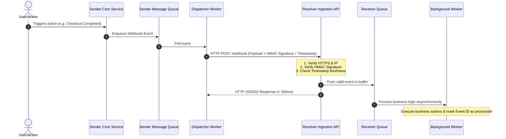

# Comprehensive Guide to Webhooks: System Design & Security

---

## 1. What is a Webhook?

A **Webhook** (also known as a *reverse API* or *web callback*) is an architectural pattern that allows one system (the **Producer/Sender**) to send automated, real-time data to another system (the **Consumer/Receiver**) as soon as a specific event occurs.

### The Real-World Analogy
* **Polling (Traditional API):** Like calling a pizza store every 2 minutes asking, *"Is my pizza ready yet?"* (Inefficient, wastes bandwidth and server resources).
* **Webhook:** Giving the pizza store your phone number and saying, *"Call or text me the moment the pizza is out of the oven."* (Event-driven, instant, and resource-efficient).

```
+----------------+      1. Event Happens (e.g. Payment Paid)      +-------------------+
| Webhook Sender | ---------------------------------------------> | Webhook Receiver  |
|  (e.g., Stripe)|      2. HTTP POST Request with JSON Body       | (Your Application)|
+----------------+ <--------------------------------------------- +-------------------+
                               3. 200 OK Response
```

---

## 2. Communication Models: When to Use What?

Understanding when to choose Webhooks versus alternative real-time or request-response technologies is a fundamental system design skill:

| Mechanism | Communication Direction | Target Environment | Connection Type | Ideal Use Case |
| :--- | :--- | :--- | :--- | :--- |
| **Webhook** | Server $\rightarrow$ Server | Backend to Backend | Short-lived HTTP POST per event | Asynchronous event notifications (Stripe payments, GitHub commits, Shopify orders). |
| **Polling** | Client $\rightarrow$ Server | Client/Server | Periodic short-lived HTTP GET | When sender does not support webhooks; checking low-frequency updates. |
| **Server-Sent Events (SSE)** | Server $\rightarrow$ Client | Server to Browser/Mobile | Single long-lived unidirectional HTTP stream | Real-time dashboards, stock price tickers, LLM streaming output. |
| **WebSockets** | Client $\leftrightarrow$ Server | Client to Server & vice-versa | Long-lived persistent full-duplex TCP connection | Interactive multiplayer games, chat apps, collaborative document editing. |

---

## 3. Webhook Architecture: High-Level System Design

A resilient webhook system consists of two distinct sides: the **Sender (Producer)** and the **Receiver (Consumer)**.



### A. Sender (Producer) Architecture
1. **Event Capture & Outbox Pattern:** When a domain event occurs in the database, write the webhook event to an transactional outbox table or message queue (e.g., Kafka, SQS, RabbitMQ).
2. **Dispatch Worker:** Reads from the queue, serializes payload, calculates signatures, and issues HTTP requests.
3. **Retry Strategy with Exponential Backoff:** If the receiver responds with `5xx`, timeouts, or network failures, retry with increasing delays (e.g., immediate, 1m, 5m, 30m, 2h, 24h).
4. **Dead Letter Queue (DLQ):** If retries are exhausted, push failed events to a DLQ for manual inspection or alerting.

### B. Receiver (Consumer) Architecture
1. **Public Endpoint:** Exposes a public HTTPS endpoint (e.g., `POST /api/v1/webhooks/stripe`).
2. **Fast Ingestion (Immediate 2xx Response):** Validate signature, persist payload to an internal queue/database, and respond with `200 OK` or `202 Accepted` within a few hundred milliseconds. Never do heavy processing synchronously in the HTTP handler.
3. **Asynchronous Worker:** Dequeues the event and handles heavy tasks (updating database, sending emails, generating receipts).

---

## 4. Webhook Security & Critical Checkpoints

Because webhook receivers expose public endpoints on the internet, anyone can attempt to send fake requests, replay old requests, or flood the server. 

### Security Checkpoint Overview

```
                          [ Incoming HTTP POST Request ]
                                        │
                                        ▼
             ┌──────────────────────────────────────────────────────┐
             │ 1. Transport Security (HTTPS Only)                   │
             └──────────────────────────┬───────────────────────────┘
                                        │ PASS
                                        ▼
             ┌──────────────────────────────────────────────────────┐
             │ 2. Timestamp Freshness Check (Prevents Replay)       │
             └──────────────────────────┬───────────────────────────┘
                                        │ PASS
                                        ▼
             ┌──────────────────────────────────────────────────────┐
             │ 3. HMAC Signature Verification (Authenticity)        │
             └──────────────────────────┬───────────────────────────┘
                                        │ PASS
                                        ▼
             ┌──────────────────────────────────────────────────────┐
             │ 4. Idempotency Check (Prevents Duplicate Processing) │
             └──────────────────────────┬───────────────────────────┘
                                        │ PASS
                                        ▼
                         [ Accept & Queue for Processing ]
```

---

### Checkpoint 1: Transport Encryption (HTTPS)
* Webhook endpoints **must strictly enforce HTTPS (TLS 1.2/1.3)**.
* Prevents eavesdropping and Man-in-the-Middle (MitM) attacks where sensitive payload data (PII, payment info) could be intercepted in transit.

---

### Checkpoint 2: Authentication & HMAC Signature Verification

#### What is HMAC?
**HMAC** stands for *Hash-based Message Authentication Code*. It provides two guarantees:
1. **Authentication:** Proves the request came from the real sender (who holds the shared secret).
2. **Integrity:** Proves the payload has not been tampered with in transit.

#### How It Works: Step-by-Step
1. **Shared Secret:** The Sender and Receiver share a secret key (generated during webhook setup).
2. **Signature Creation (Sender Side):**
   * Sender takes the **raw request body string** and computes:
     $$\text{Signature} = \text{HMAC-SHA256}(\text{Raw Payload Body}, \text{Shared Secret})$$
   * Sender sends this signature in an HTTP header (e.g., `X-Signature-SHA256` or `Stripe-Signature`).
3. **Signature Verification (Receiver Side):**
   * Receiver reads the **raw unparsed body** and re-computes the HMAC using the same shared secret.
   * Receiver compares the computed signature against the incoming header using a **constant-time string comparison** (to prevent timing attacks).

> [!CAUTION]
> **Raw Body vs Parsed JSON Body:**
> Always compute the HMAC against the raw binary/text byte stream received over the wire. If your web framework parses JSON before computing HMAC, key ordering, whitespaces, or unicode formatting may change, causing signature validation to fail.

#### Code Example (Python / FastAPI & Flask):

```python
import hmac
import hashlib
import json
import os
from fastapi import FastAPI, Request, HTTPException, Header, status

app = FastAPI()
WEBHOOK_SECRET = os.environ.get("WEBHOOK_SECRET", "my_super_secret_key").encode("utf-8")

@app.post("/webhook")
async def handle_webhook(
    request: Request,
    x_signature_sha256: str = Header(None)
):
    if not x_signature_sha256:
        raise HTTPException(
            status_code=status.HTTP_401_UNAUTHORIZED,
            detail="Missing signature header"
        )

    # 1. Capture raw byte stream BEFORE parsing JSON
    raw_body = await request.body()

    # 2. Calculate expected HMAC-SHA256 signature
    expected_signature = hmac.new(
        WEBHOOK_SECRET,
        msg=raw_body,
        digestmod=hashlib.sha256
    ).hexdigest()

    # 3. Constant-time string comparison (prevents timing attacks)
    is_valid = hmac.compare_digest(x_signature_sha256, expected_signature)

    if not is_valid:
        raise HTTPException(
            status_code=status.HTTP_403_FORBIDDEN,
            detail="Invalid signature"
        )

    # 4. Signature verified! Safe to parse payload and dispatch to queue
    payload = json.loads(raw_body.decode("utf-8"))
    
    # Enqueue event for background worker processing (e.g., Redis, Celery, SQS)
    # enqueue_event(payload)

    return {"received": True}
```

---

### Checkpoint 3: Replay Attack Prevention (Timestamps + Nonce)

#### What is a Replay Attack?
An attacker intercepts a legitimate, signed webhook request over the network (or from logs) and sends the exact same payload repeatedly to the receiver's endpoint (e.g., repeating a "credit 100 reward points" event). Because the signature is valid for that payload, naive signature verification would pass.

#### Mitigation:
1. **Timestamp in Signature Header:** Senders include a timestamp in the header (e.g., `t=1728500000`) and sign both the timestamp and the payload together:
   $$\text{Signature} = \text{HMAC-SHA256}(t + "." + \text{Raw Payload}, \text{Secret})$$
2. **Tolerance Window:** The receiver checks $| \text{Current Time} - t | \le \text{Threshold}$ (typically 5 minutes). Any request older than 5 minutes or too far into the future is discarded.

---

### Checkpoint 4: Idempotency (Handling Duplicate Events)

#### Why Duplicate Events Occur:
Webhooks operate under an **"At-Least-Once" delivery guarantee**. If the sender issues a request and a network timeout occurs right before receiving your `200 OK`, the sender will retry. Your receiver endpoint will receive the exact same event twice.

#### How to Build Idempotent Receivers:
1. Senders must attach a unique identifier to every event (e.g., `id: "evt_1N4xyz987"`).
2. The receiver maintains an `idempotency_keys` or `processed_events` table with a **unique constraint** on `event_id`.
3. When receiving an event:
   * Try inserting `event_id` into the database.
   * If insertion fails with a unique constraint violation (duplicate key), skip processing and return `200 OK` immediately.

```sql
CREATE TABLE processed_webhook_events (
    event_id VARCHAR(255) PRIMARY KEY,
    event_type VARCHAR(100) NOT NULL,
    received_at TIMESTAMP WITH TIME ZONE DEFAULT CURRENT_TIMESTAMP
);
```

---

### Checkpoint 5: Additional Security Layers (Enterprise Hardening)
* **IP Whitelisting / CIDR Blocks:** Senders publish a static list of IP addresses from which webhooks originate. Receivers reject connections from unauthorized IPs.
* **Mutual TLS (mTLS):** Both sender and receiver present X.509 certificates to establish a cryptographically verified two-way trusted connection.
* **Rate Limiting:** Protect receiver endpoints with rate limiters (e.g., Token Bucket / Leaky Bucket) to guard against DDoS or accidental retry storms.

---

## 5. Resilience & Reliability Best Practices

### A. The "Fast ACK" Rule (Asynchronous Ingestion)
> [!IMPORTANT]
> **Never perform slow business logic inside the Webhook HTTP handler.**
> If your handler takes longer than 3–5 seconds (e.g., PDF generation, database migrations, 3rd party calls), the sender's HTTP client will time out, classify the delivery as failed, and retry. This leads to retry loops and resource exhaustion.

* **Pattern:** `Receive` $\rightarrow$ `Verify Signature` $\rightarrow$ `Push to Internal Queue (SQS/Redis)` $\rightarrow$ `Return HTTP 200/202` $\rightarrow$ `Process in Worker`.

### B. Out-of-Order Delivery Handling
Due to network routing and retries, Event B (created at 10:05) might arrive at your server before Event A (created at 10:00).
* **Solution:** Always store and compare an event timestamp or version counter on the target resource. Ignore updates that contain older timestamps than the current database state.

### C. Secret Rotation (Zero-Downtime Secret Rolling)

#### Why is Secret Rotation Hard?
If your server only supports a single secret (`WEBHOOK_SECRET`), rotating it causes downtime:
* If you change the secret on your server first $\rightarrow$ the sender is still signing with the old secret $\rightarrow$ all incoming webhooks fail (`403 Forbidden`).
* If the sender switches to the new secret first $\rightarrow$ your server hasn't deployed the new key yet $\rightarrow$ all incoming webhooks fail (`403 Forbidden`).

#### The Solution: The "Dual-Secret" Rolling Window
To achieve **zero-downtime rotation**, the receiver must accept requests signed with **either the current secret OR the new secret** during the transition window.

```
                      [ Secret Rotation 3-Step Lifecycle ]
                      
  Step 1: Prep Receiver          Step 2: Switch Provider         Step 3: Clean Up
┌─────────────────────────┐    ┌─────────────────────────┐    ┌─────────────────────────┐
│ Receiver accepts:       │    │ Provider switches       │    │ Receiver accepts:       │
│ • Secret_V1 (Current)   │ ──>│ active signing key to:  │ ──>│ • Secret_V2 (Current)   │
│ • Secret_V2 (Next)      │    │ • Secret_V2             │    │ (Secret_V1 removed)     │
└─────────────────────────┘    └─────────────────────────┘    └─────────────────────────┘
```

#### How Secrets are Stored:
Instead of a single variable, secrets can be stored as a comma-separated list in environment variables or loaded from a Secret Manager (AWS Secrets Manager, HashiCorp Vault):
```bash
# In .env or Environment Variables
WEBHOOK_SECRETS="sec_live_newVersion2026,sec_live_oldVersion2025"
```

#### Python Implementation for Multi-Secret Verification:
```python
import hmac
import hashlib
import os
from typing import List

# Read multiple active secrets from environment variable (comma-separated)
def get_active_webhook_secrets() -> List[bytes]:
    raw_secrets = os.environ.get("WEBHOOK_SECRETS", "default_secret")
    return [s.strip().encode("utf-8") for s in raw_secrets.split(",") if s.strip()]

def verify_webhook_signature(raw_body: bytes, incoming_signature: str) -> bool:
    active_secrets = get_active_webhook_secrets()
    
    # Try verifying against ANY of the currently active valid secrets
    for secret in active_secrets:
        expected_signature = hmac.new(
            secret,
            msg=raw_body,
            digestmod=hashlib.sha256
        ).hexdigest()
        
        # Constant-time comparison
        if hmac.compare_digest(incoming_signature, expected_signature):
            return True # Verified with one of the valid secrets!
            
    return False # Failed verification across all active secrets
```

---

## 6. Summary Checklist

### For Webhook Providers (Senders):
- [ ] Use HTTPS exclusively for all webhook deliveries.
- [ ] Sign all payloads using **HMAC-SHA256** with a shared secret.
- [ ] Include a timestamp in the signature header to defend against replay attacks.
- [ ] Include a unique `event_id` in every payload for idempotency.
- [ ] Implement exponential backoff with jitter on retries.
- [ ] Implement a Dead Letter Queue (DLQ) and auto-disable endpoints that fail continuously.

### For Webhook Consumers (Receivers):
- [ ] Expose an HTTPS-only endpoint.
- [ ] Verify HMAC signatures using raw request body buffers and constant-time string comparisons.
- [ ] Validate timestamp freshness (e.g., within a 5-minute tolerance window).
- [ ] Enforce idempotency using database unique constraints on `event_id`.
- [ ] Respond immediately with `200 OK` or `202 Accepted` after queuing the event.
- [ ] Process long-running business tasks asynchronously in background workers.